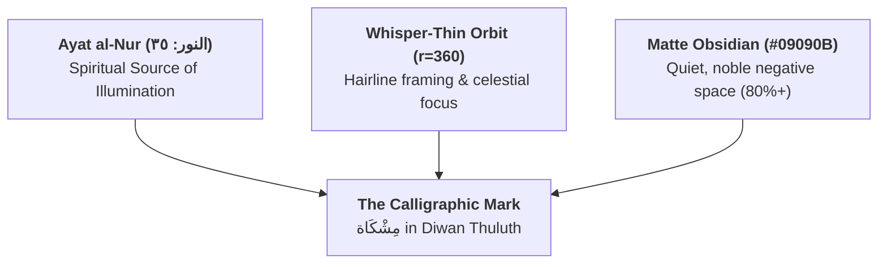
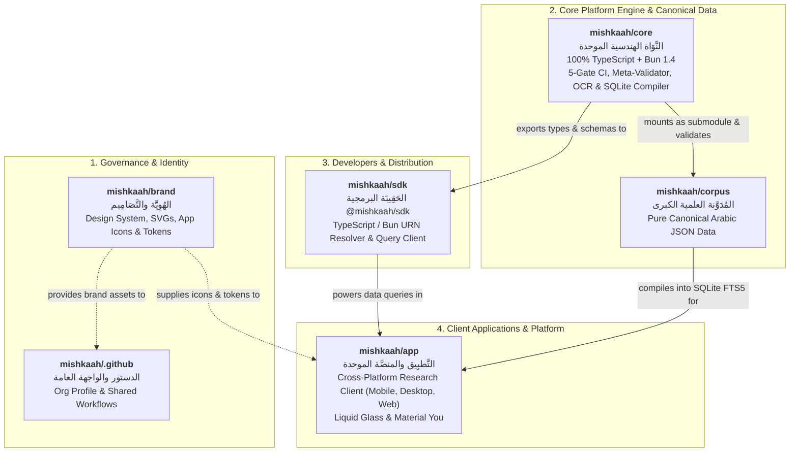

# 🏛️ Mishkaah Brand & Organization Architecture (`BRAND_AND_ORG_ARCHITECTURE.md`)
**Official GitHub Organization**: [`https://github.com/mishkaah`](https://github.com/mishkaah) | **Brand**: Mishkaah (مِشْكَاة) | **Version**: 2.2.0

---

## 1. Brand Philosophy & Spiritual Anchor

The name and spiritual heart of **Mishkaah (مِشْكَاة)** are drawn directly from the Verse of Light (*Ayat al-Nur*, Surah Al-Nur 24:35):

> **﴿اللَّهُ نُورُ السَّمَاوَاتِ وَالْأَرْضِ ۚ مَثَلُ نُورِهِ كَمِشْكَاةٍ فِيهَا مِصْبَاحٌ ۖ الْمِصْبَاحُ فِي زُجَاجَةٍ ۖ الزُّجَاجَةُ كَأَنَّهَا كَوْكَبٌ دُرِّيٌّ﴾**
> *"Allah is the Light of the heavens and the earth. The example of His light is like a niche within which is a lamp; the lamp is within glass, the glass as if it were a pearlescent star..."*

### Architectural & Scholarly Metaphor
A **Mishkah (مِشْكَاة)** is a sacred architectural wall-niche designed to hold, shield, and concentrate the illumination of a lamp without dissipation:
- **The Niche (*Al-Mishkah*)**: Our immutable mathematical container — strict Zod schemas (`.strict()`), 5-Gate deterministic CI verification, Layer 0 Meta-Validator with SHA-256 lockfiles and canary poison suites.
- **The Glass (*Al-Zujajah*)**: Pure, uncorrupted, fully vocalized Arabic texts collated forensically against authenticated printed editions (*Muqabalah*).
- **The Lamp (*Al-Misbah*)**: The eternal revelation of the Noble Quran (10 Qira'at / 20 Riwayat), the authentic Prophetic Sunnah, classical Tafseer, Mutun, and the 3-Layer Arabic Lexical Architecture.

We treat sacred scripture and scholarly inheritance with utmost veneration, mathematical rigor, and quiet, museum-grade elegance (*Geometric Silence*).

---

## 2. Logo & Sovereign Calligraphic Seal System

The official identity of Mishkaah centers upon the **Sovereign Calligraphic Seal of مِشْكَاة**: an authentic masterwork of classical Arabic calligraphy (*Diwan Thuluth*) rendered in liquid champagne gold upon a matte obsidian sanctuary:



### Visual Anatomy of the Seal:
1. **The Calligraphic Inscription (*Matn al-Ism*)**:
   - The sacred name **مِشْكَاة** is rendered in master classical Thuluth script.
   - The sweeping sword stroke of the *Kaf* (ك) arches gracefully above the word, embracing the crowned teeth of the *Sheen* (ش), the grounded aperture of the *Meem* (م), and the regal ascenders of the *Alef* (ا) and *Ta Marbuta* (ة).
   - Authentic scholarly *harakat* (kasrah, fathah) provide organic orthographic detail and centuries of manuscript heritage.
2. **The Whisper-Thin Hairline Orbit**:
   - A single subtle hairline ring ($r = 360\text{px}$, stroke `#C8A96A`, opacity `0.28`, stroke-width `1.5px`) frames the calligraphy on a $1024\times1024$ canvas.
3. **Quiet, Museum-Grade Restraint**:
   - Zero generic clip-art icons or artificial wireframe lines.
   - Zero badge clutter or decorative noise.
   - Over 80% pure negative space on matte obsidian `#09090B`.

### Master Brand Assets:
- **Dark Sovereign Seal**: [`./logos/mishkaah-mark-dark.svg`](./logos/mishkaah-mark-dark.svg) | High-Res PNG: [`./logos/mishkaah-mark-dark.png`](./logos/mishkaah-mark-dark.png) (1024×1024)
- **Transparent Gold Seal**: [`./logos/mishkaah-mark-gold-transparent.svg`](./logos/mishkaah-mark-gold-transparent.svg) | High-Res PNG: [`./logos/mishkaah-mark-gold-transparent.png`](./logos/mishkaah-mark-gold-transparent.png) (1024×1024)
- **Monogram Mark**: [`./logos/mishkaah-monogram-dark.svg`](./logos/mishkaah-monogram-dark.svg) | High-Res PNG: [`./logos/mishkaah-monogram-dark.png`](./logos/mishkaah-monogram-dark.png) (1024×1024)
- **Social & Header Banner**: [`./banners/mishkaah-social-banner.svg`](./banners/mishkaah-social-banner.svg) | High-Res PNG: [`./banners/mishkaah-social-banner.png`](./banners/mishkaah-social-banner.png) (2560×1280 retina)

---

## 3. Official Color System & Design Tokens

Mishkaah adheres to a restricted 4-color palette engineered for supreme legibility, sacred serenity, and WCAG AAA compliance:

| Color Token | Hex Code | Role | Contrast Ratio |
| :--- | :--- | :--- | :--- |
| **Matte Obsidian** | `#09090B` | Canonical dark canvas, background sanctuary, OLED black | Baseline |
| **Warm Parchment Alabaster** | `#F6F3EC` | Canonical light canvas, paper reading mode | Baseline |
| **Champagne Gold** | `#E5CFA0` → `#B89655` | Primary calligraphic mark, sovereign seal, active halos | **11.4:1** on Obsidian |
| **Deep Umber Bronze** | `#8A6B2F` → `#553F16` | Light mode calligraphy, classical manuscript ink | **12.8:1** on Alabaster |

Strict machine-readable JSON design tokens:
- Colors: [`./tokens/colors.json`](./tokens/colors.json)
- Typography: [`./tokens/typography.json`](./tokens/typography.json)

---

## 4. Typography Stack

- **Brandmark & Monogram**: *Diwan Thuluth* (classical master ligature stacking, full vocalization).
- **Quranic Scripture**: *KFGQPC Uthmanic Script HAFS* (King Fahd Complex authentic standard).
- **Classical Islamic Prose**: *Amiri* / *Amiri Quran* / *Traditional Arabic*.
- **Modern Arabic UI**: *SF Arabic* (iOS/macOS) / *Noto Sans Arabic* (Android/Linux).
- **Latin & Numerals**: *SF Pro Rounded* (iOS) / *Inter* (Android/Web).
- **Code & Metadata**: *JetBrains Mono* / *SF Mono*.

---

## 5. Mobile App Icon & Adaptive OS System (iOS 18+ HIG & Android 13–15+)

To guarantee 100% optical clarity and eliminate border collision with OS squircle or circle masks, the Mobile App Icon strips the outer ring and centers the compact calligraphic *Tughra* emblem **`مِشْكَاة`** strictly within the **Android 66/108dp (61%) Safe Zone**:

```
+-------------------------------------------------------------+
| 1024×1024 (108×108dp) Full Canvas                           |
|                                                             |
|       +---------------------------------------------+       |
|       | 624×624 (66×66dp / 61%) Safe Zone           |       |
|       | (r = 312px boundary)                        |       |
|       |                                             |       |
|       |                  مِشْـكَـاة                   |       |
|       |         Diwan Thuluth Emblem (r=244.7px)    |       |
|       |                                             |       |
|       +---------------------------------------------+       |
|                                                             |
+-------------------------------------------------------------+
```

### Production App Icon Deliverables:
All icons reside in [`./app-icons/`](./app-icons/):
1. **`app-icon-dark.svg` / `.png`** (iOS 18+ Dark Mode & Default Dark):
   - Background: Pure Matte Obsidian (`#09090B`).
   - Foreground: Champagne Gold gradient (`#E5CFA0` → `#B89655`), contrast ratio 11.4:1.
2. **`app-icon-light.svg` / `.png`** (iOS 18+ Light Mode & Default Light):
   - Background: Warm Parchment Alabaster (`#F6F3EC`).
   - Foreground: Deep Umber Bronze (`#8A6B2F` → `#553F16`), contrast ratio 12.8:1.
3. **`app-icon-tinted.svg` / `.png`** (iOS 18+ Tinted Mode & Android Dynamic Color):
   - Flat single-channel monochrome silhouette (`#FFFFFF`) on transparent canvas.
4. **`android-adaptive-foreground.svg` / `.png`**:
   - `1024×1024` transparent canvas with mark strictly confined within $R = 244.7\text{px} \ll 312\text{px}$ (66dp safe zone). Guaranteed zero clipping across circular, squircle, or teardrop Android launcher masks.
5. **`android-adaptive-background-dark.svg`** (`#09090B`) & **`android-adaptive-background-light.svg`** (`#F6F3EC`).
6. **`app-icon-showcase-grid.svg` / `.png`** (1600×900 / 3200×1800 retina):
   - Executive presentation board displaying iOS 18 Dark, iOS 18 Light, iOS 18 Tinted, and Android Adaptive side-by-side with safe-zone guides and contrast metrics.

---

## 6. Multi-Repository Ecosystem under `github.com/mishkaah`

The platform architecture is unified into a lean **6-Repository Organization** within [`https://github.com/mishkaah`](https://github.com/mishkaah):



### The 6 Repositories Breakdown:

| # | Repository | Arabic Title | Description & Scope | Tech Stack |
| :--- | :--- | :--- | :--- | :--- |
| **1** | [`mishkaah/.github`](https://github.com/mishkaah/.github) | **الدستور والواجهة العامة** | Global organization profile, shared GitHub Actions workflows, security policies, and issue templates. | Markdown, GitHub Actions |
| **2** | [`mishkaah/brand`](https://github.com/mishkaah/brand) | **الهُوِيَّة والتَّصَامِيم** | Master branding identity, vector marks, banners, iOS 18+ & Android Adaptive app icons, and JSON design tokens. | SVG, PNG, JSON |
| **3** | [`mishkaah/corpus`](https://github.com/mishkaah/corpus) | **المُدَوَّنة العلمية الكبرى** | Canonical data repository: 100% Arabic JSON records across 6 domains (Quran, Hadith, Tafseer, Mutun, Ma'ajim, Knowledge Graph) + stand-off `corpus/translations/en/` overlays. | Strict JSON, Git Submodule |
| **4** | [`mishkaah/core`](https://github.com/mishkaah/core) | **النَّوَاة الهندسية** | Unified engineering engine: strict Zod schemas, Layer 0 Meta-Validator, 5-Gate CI verifiers, manuscript OCR & collation, and SQLite compilation engine. | 100% TypeScript, Bun 1.4, Zod, SQLite/FTS5 |
| **5** | [`mishkaah/sdk`](https://github.com/mishkaah/sdk) | **الحَقِيبَة البرمجية** | Official `@mishkaah/sdk` package for developers: URN parser/resolver, TypeScript types, schema validators, and local SQLite query client. | TypeScript, Bun, npm package |
| **6** | [`mishkaah/app`](https://github.com/mishkaah/app) | **التَّطبِيق والمنصَّة** | Unified cross-platform research and reader client (iOS, Android, macOS, Windows, Linux, and Web). Offline-first SQLite search, Liquid Glass UI, and adaptive theming. | Flutter / Kotlin Multiplatform |
