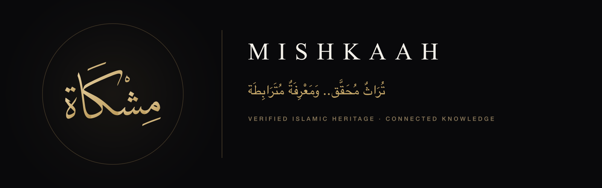

[English](./README.md) · **العربية**

# منظومة الهوية والتصميم لمشروع مِشْكَاة

### **نَصٌّ مَصُون.. وَعِلْمٌ مَأْمُون**
### **Preserved Text. Trusted Knowledge.**

---

## عن المستودع

يحتوي مستودع **`mishkaah/brand`** على عناصر الهوية البصرية الرسمية، والشعارات الخطية المتجهة (Vector)، وأيقونات تطبيقات الهواتف الذكية، ولافتات المستودعات الرقمية، والرسوم المتحركة التفاعلية، ورموز التصميم، وأدلة الهوية الشاملة لكافة أركان منظومة **مِشْكَاة**.

تستمد الهوية إلهامها ومعناها من آية النور (*سورة النور: ٣٥*). ويجسد الرمز البصري مشكاةً معماريةً تحتضن التراث العلمي الإسلامي الأصيل من خلال لوحة خطية عربية متقنة بخط الثلث الديواني:

- **الشعار الخطي الأساسي**: اسم **مِشْكَاة** كاملاً ومشكولاً بخط الثلث الديواني الأصيل. ويُستخدم في كافة الواجهات الرسمية والترويسات والوثائق المعتمدة.
- **المونوغرام الفرعي**: حرف **الميم** الأولي (مـ) بخط الثلث الديواني، مصمم خصيصاً للمساحات الدقيقة (٤٨ بكسل أو أقل) وأيقونات المواقع (Favicons) والصور الرمزية الدائرية.

---

## خريطة المستودع ومعرض الأصول

| المجلد | النطاق والمحتويات | الصيغ المتاحة | الدليل التفصيلي |
| :--- | :--- | :--- | :--- |
| [**`logos/`**](./logos/README.ar.md) | الشعارات الخطية الأساسية، والتراكيب الأفقية، ومونوغرام حرف الميم | `.svg`, `.png`, `.webp` | [دليل الشعارات](./logos/README.ar.md) |
| [**`app-icons/`**](./app-icons/README.ar.md) | أيقونات iOS 18+ (الداكن والفاتح والمصبوغ)، ونظام Android التكيفي، وأيقونات المواقع | `.svg`, `.png`, `.ico` | [دليل الأيقونات](./app-icons/README.ar.md) |
| [**`banners/`**](./banners/README.ar.md) | بطاقات المشاركة الاجتماعية (1280×640)، ولافتة المنظمة (1600×500)، ولافتات أركان المستودعات الأربعة (1280×420) | `.svg`, `.png` | [دليل اللافتات](./banners/README.ar.md) |
| [**`animations/`**](./animations/README.ar.md) | الرسوم المتحركة البصرية: ملفات SVG التفاعلية، وحزم Lottie JSON، ومقاطع الفيديو 60 إطاراً (16:9, 9:16, 1:1) | `.svg`, `.lottie.json`, `.mp4`, `.webm` | [دليل الرسوم المتحركة](./animations/README.ar.md) |
| [**`tokens/`**](./tokens/README.ar.md) | لوحات الألوان، وموازين الخطوط، ومنحنيات الحركة، وحزم CSS وTypeScript وDart المجمعة | `.json`, `.css`, `.ts`, `.dart` | [دليل رموز التصميم](./tokens/README.ar.md) |
| [**`docs/`**](./docs/README.ar.md) | الأدلة الإرشادية التفصيلية: دليل الهوية الشامل، وفنون الخط، ونظام الألوان، ومعايير الحركة | `.md`, `.pdf` | [وثائق الهوية](./docs/README.ar.md) |
| [**`scripts/`**](./scripts/README.ar.md) | سكربتات البناء والتحويل الآلي لاستخراج مسارات Bezier عبر CoreText في macOS | `.ts` | [دليل السكربتات](./scripts/README.ar.md) |

### كتيّبات الهوية البصرية ومواد العرض
- **كتاب الهوية البصرية المطبوع (PDF)**: [`docs/presentations/mishkaah-brand-book.pdf`](./docs/presentations/mishkaah-brand-book.pdf)
- **لوحة الملخص التنفيذي للهوية**: [`docs/presentations/brand-identity-sheet.png`](./docs/presentations/brand-identity-sheet.png)

---

## الروابط العامة الثابتة للأصول الرقمية

تعتمد كافة مستودعات منظومة مِشْكَاة ([`core`](https://github.com/mishkaah/core), [`corpus`](https://github.com/mishkaah/corpus), [`sdk`](https://github.com/mishkaah/sdk), [`app`](https://github.com/mishkaah/app), [`.github`](https://github.com/mishkaah/.github)) بالإضافة إلى المواقع والتطبيقات الخارجية على روابط GitHub المباشرة الثابتة التالية. يضمن هذا الترتيب تحديث كافة الأصول في كل المواضع تلقائياً فور تحسين أي ملف في هذا المستودع.

| وصف الأصل البصري | النمط / الصيغة | الرابط الثابت المباشر (Raw GitHub URL) |
| :--- | :--- | :--- |
| **الشعار الأساسي (داكن)** | رسم متجه SVG (1024×1024) | `https://raw.githubusercontent.com/mishkaah/brand/main/logos/mark-dark.svg` |
| **الشعار الأساسي (ذهبي شفاف)** | رسم متجه SVG (1024×1024) | `https://raw.githubusercontent.com/mishkaah/brand/main/logos/mark-gold-transparent.svg` |
| **الشعار الأساسي (فاتح)** | رسم متجه SVG (1024×1024) | `https://raw.githubusercontent.com/mishkaah/brand/main/logos/mark-light.svg` |
| **مونوغرام الميم (داكن)** | رسم متجه SVG (1024×1024) | `https://raw.githubusercontent.com/mishkaah/brand/main/logos/monogram-dark.svg` |
| **مونوغرام الميم (ذهبي شفاف)** | رسم متجه SVG (1024×1024) | `https://raw.githubusercontent.com/mishkaah/brand/main/logos/monogram-gold-transparent.svg` |
| **التركيب الأفقي (داكن)** | رسم متجه SVG (1600×400) | `https://raw.githubusercontent.com/mishkaah/brand/main/logos/lockup-horizontal-dark.svg` |
| **التركيب الأفقي (فاتح)** | رسم متجه SVG (1600×400) | `https://raw.githubusercontent.com/mishkaah/brand/main/logos/lockup-horizontal-light.svg` |
| **لافتة المنظمة الرئيسية** | رسم متجه SVG (1600×500) | `https://raw.githubusercontent.com/mishkaah/brand/main/banners/github-hero-dark.svg` |
| **بطاقة المشاركة الاجتماعية** | رسم متجه SVG (1280×640) | `https://raw.githubusercontent.com/mishkaah/brand/main/banners/social-og-dark.svg` |
| **لافتة مستودع المُدَوَّنة (Corpus)** | رسم متجه SVG (1280×420) | `https://raw.githubusercontent.com/mishkaah/brand/main/banners/repo-banner-corpus.svg` |
| **لافتة مستودع النَّوَاة (Core)** | رسم متجه SVG (1280×420) | `https://raw.githubusercontent.com/mishkaah/brand/main/banners/repo-banner-core.svg` |
| **لافتة مستودع الحَقِيبَة (SDK)** | رسم متجه SVG (1280×420) | `https://raw.githubusercontent.com/mishkaah/brand/main/banners/repo-banner-sdk.svg` |
| **لافتة مستودع التَّطْبِيقَات (App)** | رسم متجه SVG (1280×420) | `https://raw.githubusercontent.com/mishkaah/brand/main/banners/repo-banner-app.svg` |
| **أيقونة التطبيق (iOS الداكن)** | صورة عالية الدقة PNG (1024×1024) | `https://raw.githubusercontent.com/mishkaah/brand/main/app-icons/ios-dark.png` |
| **أيقونة التطبيق (Android التكيفية)** | رسم متجه أمامي متكيف SVG | `https://raw.githubusercontent.com/mishkaah/brand/main/app-icons/android-adaptive-foreground.svg` |
| **شعار الظهور المتحرك** | رسم متجه متحرك SVG | `https://raw.githubusercontent.com/mishkaah/brand/main/animations/svg/mishkaah-reveal-dark.svg` |
| **حزمة الرسوم للهواتف (Lottie)** | ملف Lottie JSON للهواتف | `https://raw.githubusercontent.com/mishkaah/brand/main/animations/lottie/mishkaah-splash-reveal-dark.lottie.json` |

---

## الثوابت البصرية الأساسية

1. **هندسة متجهة نقية ومستقلة**: تحتوي كافة ملفات SVG على مسارات منحنيات Bezier تكعيبية مغلقة ومستخرجة برمجياً عبر CoreText. لا تحتوي الملفات على وسوم `<text>` نهائياً، مما يلغي أي اعتماد على تثبيت الخطوط.
2. **تباين بصري متفوق (معيار WCAG AAA)**: يحقق التباين بين الأسود المطفي (`#09090B`) والذهب التراثي (`#E5CFA0` ← `#B89655`) نسبة **11.4:1**، بينما يحقق النمط الفاتح (`#F6F3EC`) مع البرونز نسبة **12.8:1**.
3. **سكينة بصرية وأصالة علمية**: صُممت الهوية بوقار ومهابة علمية تعتمد على المساحات الهادئة والانضباط الرياضي بعيداً عن التكلف والزخرفة الزائدة.
