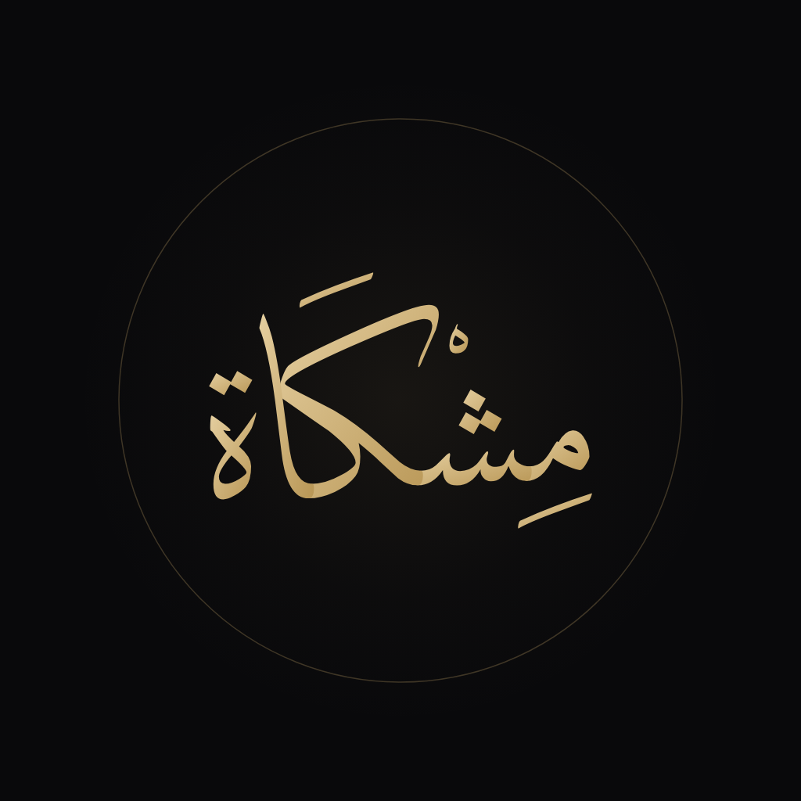
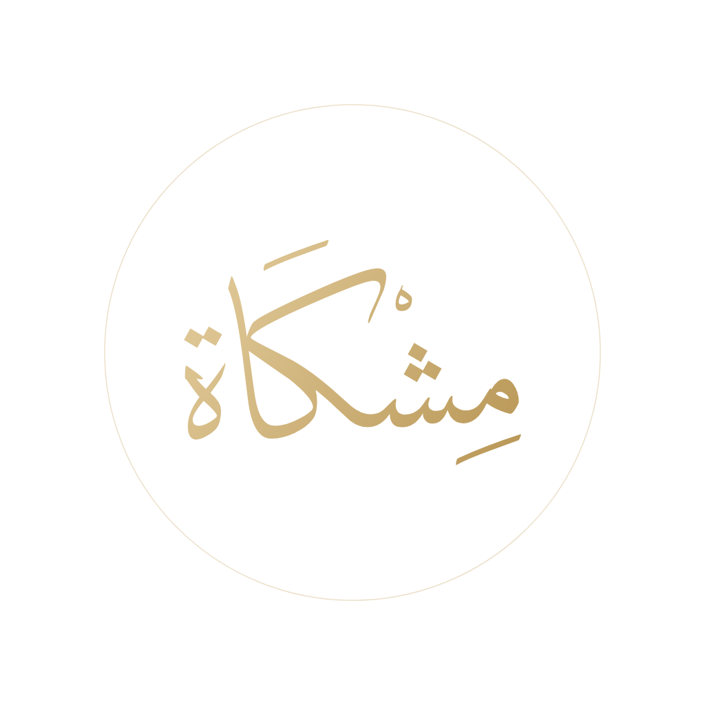
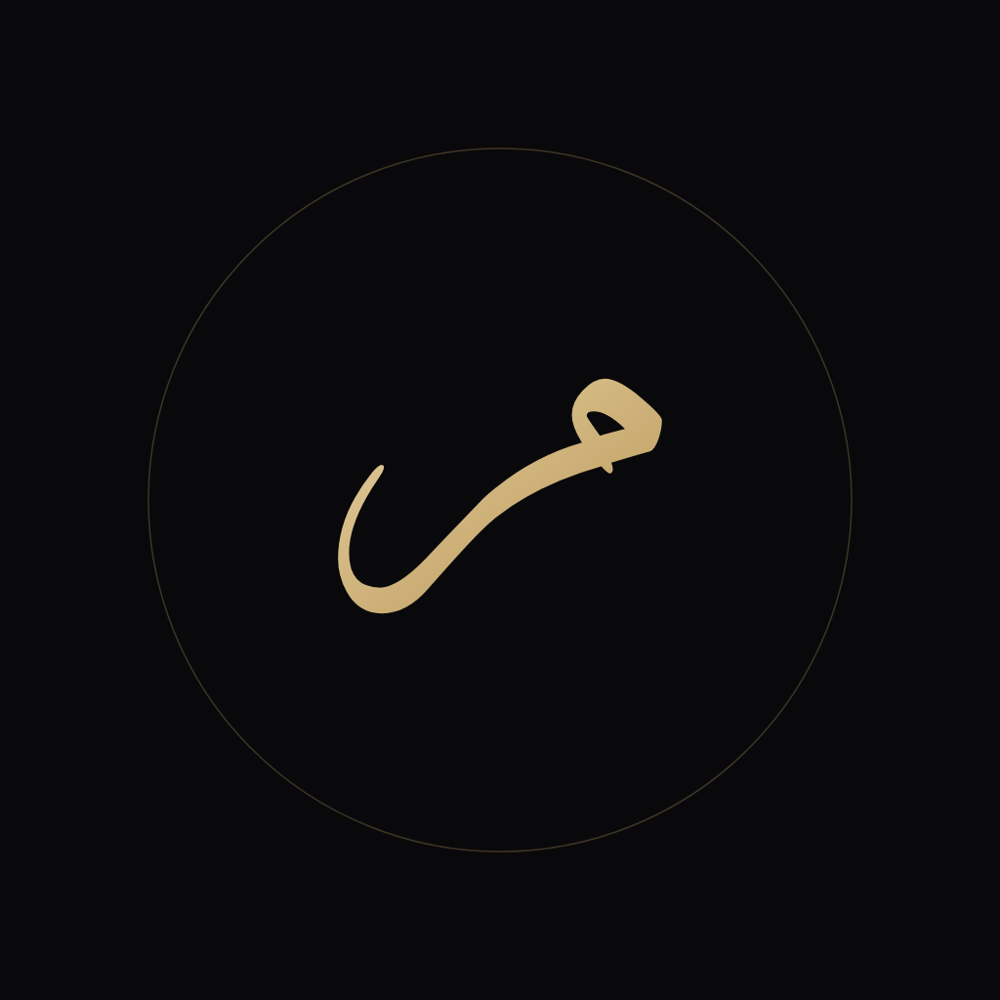
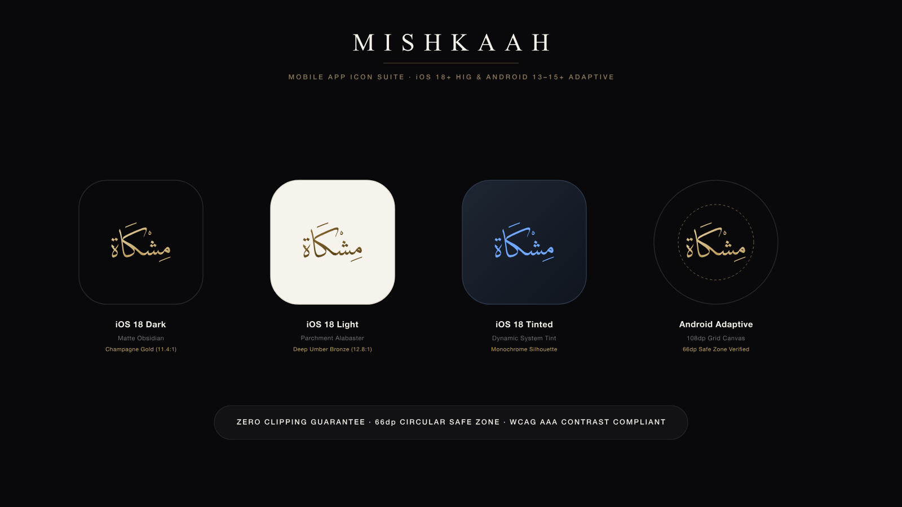
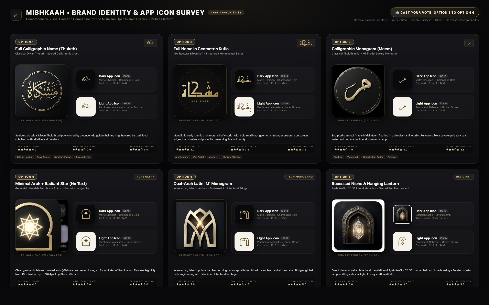

# 🏛️ Mishkaah Brand & Design Assets (`mishkaah/brand`)

### **Mishkaah · مِشْكَاة**
**Visual Identity, Calligraphic Logos, Adaptive App Icons, and Design Tokens**

**English** · [العربية](./README.ar.md)

---

## Overview

The **`mishkaah/brand`** repository hosts the official visual identity, master calligraphic emblems, iOS 18+ and Android 13–15+ adaptive app icons, and JSON design tokens for **Mishkaah (مِشْكَاة)**.

Mishkaah brings together all authentic Islamic materials a Muslim needs (Quran, Tafseer, Hadith, Adhkar, classical primers & commentaries, scholar biographies, and classical Arabic dictionaries) into a single beautiful web and mobile app ([`mishkaah/app`](https://github.com/mishkaah/app)) backed by verified open data ([`mishkaah/corpus`](https://github.com/mishkaah/corpus)).

---

## 🎨 Master Brand Marks

The classical Arabic calligraphy (`مِشْكَاة`) rendered in *Diwan Thuluth* on matte dark `#09090B` background:

| Dark Calligraphic Mark | Transparent Gold Mark | Monogram Emblem (Meem) |
| :---: | :---: | :---: |
|  |  |  |
| [`Vector SVG`](./logos/mishkaah-mark-dark.svg) • [`PNG`](./logos/mishkaah-mark-dark.png) | [`Vector SVG`](./logos/mishkaah-mark-gold-transparent.svg) • [`PNG`](./logos/mishkaah-mark-gold-transparent.png) | [`Vector SVG`](./logos/mishkaah-monogram-dark.svg) • [`PNG`](./logos/mishkaah-monogram-dark.png) |

---

## 📱 Mobile App Icon Suite (iOS 18+ HIG & Android 13–15+)

Engineered specifically to prevent mask-clipping across iOS squircles, Android circles, and Material You dynamic color theming. The pure *Diwan Thuluth* calligraphic emblem **`مِشْكَاة`** sits strictly within the **66dp / 61% Android circular safe zone** (`R = 244.7px < 312px`):

### Icon Deliverables:
- **iOS 18 Dark Mode & Default Dark**: [`./app-icons/app-icon-dark.svg`](./app-icons/app-icon-dark.svg) ([PNG](./app-icons/app-icon-dark.png)) — 11.4:1 contrast ratio (exceeds WCAG AAA).
- **iOS 18 Light Mode & Default Light**: [`./app-icons/app-icon-light.svg`](./app-icons/app-icon-light.svg) ([PNG](./app-icons/app-icon-light.png)) — 12.8:1 contrast ratio.
- **iOS 18 Tinted Mode & Android Dynamic**: [`./app-icons/app-icon-tinted.svg`](./app-icons/app-icon-tinted.svg) ([PNG](./app-icons/app-icon-tinted.png)) — flat monochrome silhouette on transparent canvas.
- **Android Adaptive Foreground**: [`./app-icons/android-adaptive-foreground.svg`](./app-icons/android-adaptive-foreground.svg) ([PNG](./app-icons/android-adaptive-foreground.png)) — guaranteed 0% clipping across all launcher shapes.
- **Android Adaptive Backgrounds**: [`./app-icons/android-adaptive-background-dark.svg`](./app-icons/android-adaptive-background-dark.svg) & [`./app-icons/android-adaptive-background-light.svg`](./app-icons/android-adaptive-background-light.svg).
- **Showcase Presentation Board**: [`./app-icons/app-icon-showcase-grid.svg`](./app-icons/app-icon-showcase-grid.svg) ([PNG](./app-icons/app-icon-showcase-grid.png)).

---

## 🗳️ Brand Identity & App Icon Survey (6 Options)

To ensure the highest aesthetic quality and community consensus, Mishkaah evaluated 6 distinct design directions on a 2400×1500 survey comparison sheet with 100% geometric consistency (280×280 primary emblems and 115×115 app icon squircles):

| # | Design Direction | Core Concept | Typography / Geometry |
| :---: | :--- | :--- | :--- |
| **1** | **Full Name — Diwan Thuluth** | Classical Arabic calligraphy with diacritics and subtle orbit ring | Master Thuluth script, 11.4:1 dark / 12.8:1 light contrast |
| **2** | **Full Name — Diwan Kufi** | Architectural Kufic script with structured geometric balance | Monumental Kufic script with English subtext |
| **3** | **Initial Monogram — Thuluth Meem** | Minimalist calligraphic monogram focusing on the initial letter *Meem* | Classical sweeping Thuluth initial *Meem* |
| **4** | **Initial Monogram — Kufi Meem** | Bold monumental Kufic initial mark inside circular gold ring | Bold geometric Kufic initial *Meem* |
| **5** | **Dual-Arch Latin 'M' Monogram** | Pointed Islamic arches forming an East-West architectural bridge | Geometric dual-arch Latin M monogram |
| **6** | **Architectural Niche & Lantern** | Ayah An-Nur 24:35 literal metaphor (*Mishkat*) with crystal lamp | Traditional architectural niche with glowing crystal lantern |

---

## 💎 Design Tokens

Machine-readable JSON design tokens ready for direct import in web, mobile, and desktop applications:
- **Colors**: [`./tokens/colors.json`](./tokens/colors.json)
- **Typography**: [`./tokens/typography.json`](./tokens/typography.json)

---

## 📜 Complete Specification

For the exhaustive brand philosophy, geometric derivations, and repository ecosystem breakdown, see:
👉 [**Brand & Organization Architecture (`BRAND_AND_ORG_ARCHITECTURE.md`)**](./BRAND_AND_ORG_ARCHITECTURE.md)
