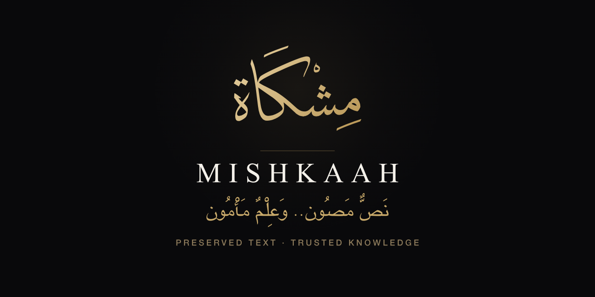

<div align="center">

[English](./README.md) · **العربية**

# لافتات المستودعات والشبكات الاجتماعية لمِشْكَاة

### **نَصٌّ مَصُون.. وَعِلْمٌ مَأْمُون**
### **Preserved Text. Trusted Knowledge.**

[](../tokens/README.ar.md)
[](../docs/brand-guidelines.ar.md)
[-10B981?style=flat-square)](../docs/color-and-theme-system.ar.md)

</div>

---

## نظرة عامة

يحتوي مجلد **`banners/`** على اللافتات البصرية وبطاقات المعاينة الاجتماعية (OpenGraph) وترويسات مستودعات الأركان الأربعة لمنظومة مِشْكَاة. صُممت كافة اللافتات بانضباط رياضي وسكينة علمية مستلهمة من آية النور، مع الحفاظ على التدرج البصري والطباعي الصارم.

<div align="center">



</div>

---

## لافتات أركان المنظومة والشعارات المعتمدة

يحظى كل ركن من أركان منظومة مِشْكَاة بلافتة مستقلة وشعار معتمد:

```
+---------------------------------------------------------------------------------------+
|                                    مُدَوَّنَةُ مِشْكَاة                                    |
|                            نَصٌّ مَصُون.. وَعِلْمٌ مَأْمُون                               |
|                         Preserved Text. Trusted Knowledge.                            |
+---------------------------------------------------------------------------------------+
|                                     نَوَاةُ مِشْكَاة                                     |
|                            نَصٌّ مَصُون.. وَعِلْمٌ مَأْمُون                               |
|                         Preserved Text. Trusted Knowledge.                            |
+---------------------------------------------------------------------------------------+
|                                      حُزْمَةُ مِشْكَاة                                     |
|                            نَصٌّ مَصُون.. وَعِلْمٌ مَأْمُون                               |
|                         Preserved Text. Trusted Knowledge.                            |
+---------------------------------------------------------------------------------------+
|                                    تَطْبِيقَاتُ مِشْكَاة                                    |
|                            نَصٌّ مَصُون.. وَعِلْمٌ مَأْمُون                               |
|                         Preserved Text. Trusted Knowledge.                            |
+---------------------------------------------------------------------------------------+
```

---

## فهرس الأصول واللافتات

| وصف اللافتة | الأبعاد | الصيغ المتاحة | المستودع / الموضع المستهدف | المحتوى الأساسي |
| :--- | :--- | :--- | :--- | :--- |
| **لافتة المنظمة الرئيسية** | 1600×500 | [`.svg`](./github-hero-dark.svg)، [`.png`](./github-hero-dark.png) | صفحة منظمة GitHub العامة ([`mishkaah`](https://github.com/mishkaah)) | الشعار الخطي والمدار الفلكي والشعار اللفظي المعتمد باللغتين |
| **بطاقة المشاركة الاجتماعية** | 1280×640 | [`.svg`](./social-og-dark.svg)، [`.png`](./social-og-dark.png) | بطاقات منصة إكس (Twitter)، لينكد إن، وفيسبوك وسلاك | نسبة أبعاد `2:1`، خلفية سبجية داكنة، خطوط ذهبية عالية التباين |
| **لافتة مستودع المُدَوَّنة (Corpus)** | 1600×500 | [`.svg`](./repo-banner-corpus.svg)، [`.png`](./repo-banner-corpus.png) | [`mishkaah/corpus`](https://github.com/mishkaah/corpus) | *نَصٌّ مَصُون.. وَعِلْمٌ مَأْمُون* |
| **لافتة مستودع النَّوَاة (Core)** | 1600×500 | [`.svg`](./repo-banner-core.svg)، [`.png`](./repo-banner-core.png) | [`mishkaah/core`](https://github.com/mishkaah/core) | *نَصٌّ مَصُون.. وَعِلْمٌ مَأْمُون* |
| **لافتة مستودع الحَقِيبَة (SDK)** | 1600×500 | [`.svg`](./repo-banner-sdk.svg)، [`.png`](./repo-banner-sdk.png) | [`mishkaah/sdk`](https://github.com/mishkaah/sdk) | *نَصٌّ مَصُون.. وَعِلْمٌ مَأْمُون* |
| **لافتة مستودع التَّطْبِيقَات (App)** | 1600×500 | [`.svg`](./repo-banner-app.svg)، [`.png`](./repo-banner-app.png) | [`mishkaah/app`](https://github.com/mishkaah/app) | *نَصٌّ مَصُون.. وَعِلْمٌ مَأْمُون* |

---

## المعايير الطباعية والهندسية

1. **نسب الأبعاد المعتمدة**:
   - ترويسة ملف المنظمة: `16:5` (`1600×500`)
   - بطاقات المشاركة الاجتماعية: `2:1` (`1280×640`)
   - ترويسات ملفات المستودعات التمهيدية: `16:5` (`1600×500`)
2. **التسلسل الهرمي للخطوط**:
   - الشعار الخطي: خط *ديوان الثلث* الكلاسيكي.
   - الشعار اللفظي العربي للركن: خط *الأميري* أو *SF Arabic* بوزن بصري متوسط `500`.
   - الشعار اللفظي الإنجليزي: خط *SF Pro Rounded* أو *Inter* بتباعد محارف `0.08em`.
3. **التوافق التام مع التباين البصري**: تحقق كافة اللافتات نسبة تباين لا تقل عن `11.4:1` (معيار WCAG AAA) بين مساحة الخلفية السبجية المطفاة (`#09090B`) والنصوص الذهبية الدافئة (`#E5CFA0` ← `#B89655`).
