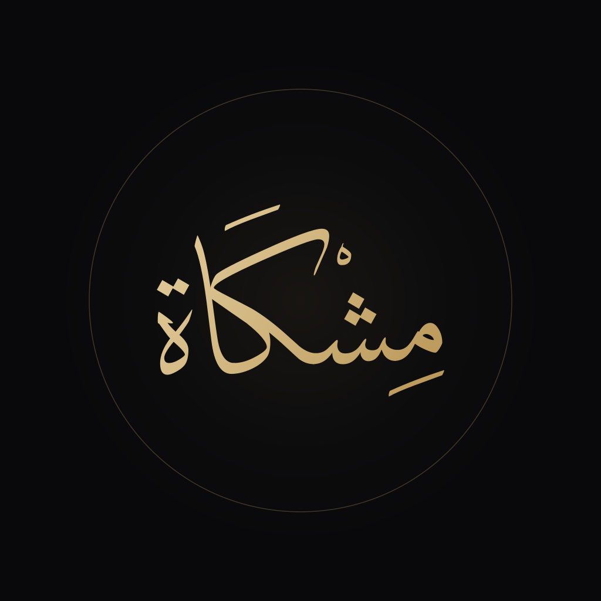
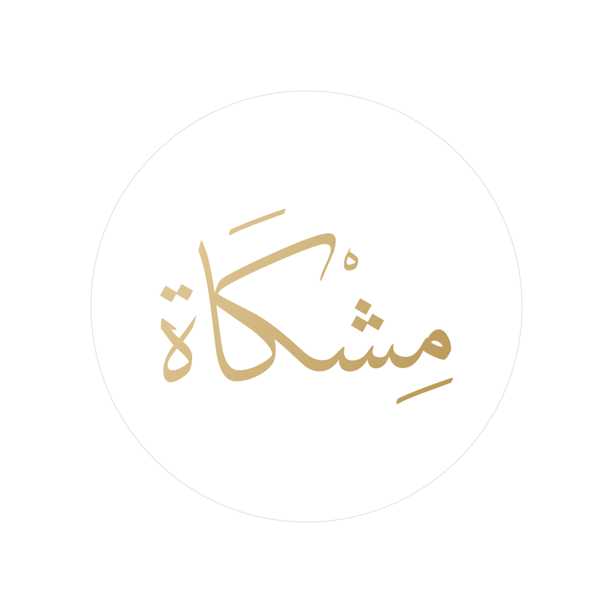
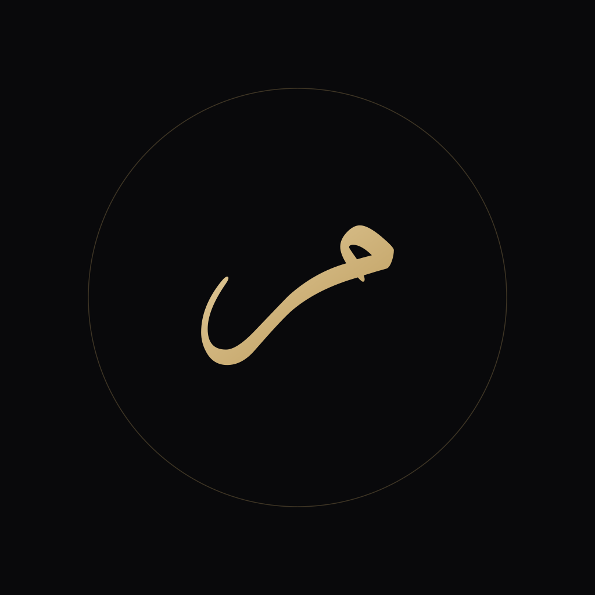

[English](./README.md) · **العربية**

# الشعارات والعلامات الخطية المتجهة لمِشْكَاة

### **نَصٌّ مَصُون.. وَعِلْمٌ مَأْمُون**
### **Preserved Text. Trusted Knowledge.**

[-10B981?style=flat-square)](../docs/typography-and-calligraphy.ar.md)

---

## نظرة عامة

يحتوي مجلد **`logos/`** على العلامات الخطية المتجهة والتركيبات الأفقية ومونوغرامات الحروف لمنظومة مِشْكَاة. تستند هذه العلامات إلى الخط العربي الكلاسيكي الأصيل، ورُسمت بعناية لتجمع بين الهيبة المعمارية والوقار التراثي والانضباط الهندسي الدقيق، مع ضمان الوضوح التام على الشاشات الرقمية فائقة الكثافة والمطبوعات الورقية الفاخرة.

ترتكز الهوية البصرية على علامتين رئيسيتين:
1. **الشعار الخطي الأساسي (`مِشْكَاة`)**: الاسم الكامل مكتوباً بخط *ديوان الثلث* داخل مدار فلكي دقيق.
2. **المونوغرام الثانوي (`مـ`)**: الحرف الأول (الميم) بخط *ديوان الثلث*، ومعد خصيصاً للمساحات الرقمية الصغيرة (`<= 48px`) والأيقونات المصغرة والصور الرمزية المستديرة.

---

## العرض البصري

| الشعار الأساسي (داكن) | الشعار الأساسي (ذهبي شفاف) | مونوغرام الميم (داكن) |
| :---: | :---: | :---: |
|  |  |  |

---

## المواصفات الهندسية والرياضية

تلتزم جميع الرسوم المتجهة في هذا المجلد بالمعايير الهندسية الصارمة التالية:

- **نظام الإحداثيات**: مساحة عمل مربعة بأبعاد `1024×1024` وحدة، ونقطة الأصل `(0, 0)` في الزاوية العلوية اليسرى، بينما يتطابق المركز البصري عند `(512, 512)`.
- **المدار الفلكي المحيط**: حلقة دائرية تتمركز عند `(512, 512)` بنصف قطر `r = 360`، وسماكة خط `1.5`، وشفافية `0.28`، مع تدرج لوني ذهبي هادئ.
- **رسم الحروف (جسم الكلمة)**: رُسمت الحروف وفق قواعد خط *ديوان الثلث* الكلاسيكي، وجرى تحويلها برمجياً إلى مسارات منحنيات بيزييه التكعيبية عبر محرك CoreText في macOS.
- **عناصر التشكيل والضبط**: وُزعت علامات الضبط (الكسرة، نقاط الشين، السكون، الفتحة، نقطتا التاء المربوطة) على محاور رأسية متوازنة بدقة هندسية.
- **استقلال تام عن الخطوط الخارجية**: لا تحتوي ملفات SVG على أي وسم نصي (`<text>`). جرى تصدير كافة العناصر كمسارات متجهة مغلقة (`<path>`)، مما يضمن عرضها بدقة مطابقة على أي منصة أو نظام تشغيل أو قارئ ملفات دون الحاجة إلى تثبيت أي خط خارجي.

---

## فهرس الأصول الرقمية

| اسم الملف | الأبعاد | الصيغة | لوحة الألوان | الموضع والاستخدام المستهدف |
| :--- | :--- | :--- | :--- | :--- |
| [`mark-dark.svg`](./mark-dark.svg) | 1024×1024 | SVG | خلفية داكنة (سبجي) + ذهب شامبين | الواجهات الداكنة الرئيسية، وثائق التوثيق، أغلفة الإصدارات |
| [`mark-light.svg`](./mark-light.svg) | 1024×1024 | SVG | خلفية بيضاء عاجية (مرمر) + برونز داكن | المخطوطات المطبوعة، الواجهات النهارية، أوراق الأبحاث العلمية |
| [`mark-gold-transparent.svg`](./mark-gold-transparent.svg) | 1024×1024 | SVG | خلفية شفافة + ذهب شامبين | الطبقات المركبة، العروض التقديمية المرئية، العلامات المائية للفيديو |
| [`monogram-dark.svg`](./monogram-dark.svg) | 1024×1024 | SVG | خلفية داكنة + حرف الميم بالذهب | أيقونات تطبيقات الهواتف الذكية، الصور الرمزية في المنصات الاجتماعية |
| [`monogram-gold-transparent.svg`](./monogram-gold-transparent.svg) | 1024×1024 | SVG | خلفية شفافة + حرف الميم بالذهب | مكونات الواجهات المصغرة، أشرطة الأدوات، شارات المسار (`<= 48px`) |
| [`lockup-horizontal-dark.svg`](./lockup-horizontal-dark.svg) | 1600×400 | SVG | خلفية داكنة + شعار وخط أفقي | أشرطة التنقل في المواقع، ترويسات المستودعات، شرائح العرض |
| [`lockup-horizontal-light.svg`](./lockup-horizontal-light.svg) | 1600×400 | SVG | خلفية فاتحة + شعار وخط أفقي برونزي | ترويسات الوثائق الرسمية، المراسلات الورقية، مسودات النشر الأكاديمي |

---

## إرشادات الاستخدام وقواعد القياس

### المساحة الآمنة المحيطة
يجب المحافظة على مساحة حماية خالية حول الشعار لا تقل عن `20%` من ارتفاع الشعار الكلي (`0.2H`). يُحظر وضع أي نصوص أو عناصر واجهة أو حدود تزيينية داخل هذه المنطقة الحامية.

### أدنى قياسات مسموح بها للإنتاج
- **الشعار الخطي الأساسي**:
  - الشاشات الرقمية: الحد الأدنى `48×48px`
  - الطباعة الورقية: الحد الأدنى `15×15mm`
- **مونوغرام الميم**:
  - الشاشات الرقمية: الحد الأدنى `16×16px` (حجم الأيقونة المصغرة Favicon)
  - الطباعة الورقية: الحد الأدنى `5×5mm`
- **التركيب الأفقي**:
  - الشاشات الرقمية: الحد الأدنى `120×30px`
  - الطباعة الورقية: الحد الأدنى `35×10mm`

### الممارسات المحظورة
- يُحظر مد الشعار أو ضغطه أو تشويه نسب أبعاده المتناسقة (`1:1`).
- يُحظر تدوير الشعار أو تغيير اتجاه خط الأساس الأفقي.
- يُحظر استبدال المدار الفلكي الدائري بأشكال مضلعة أو بيضاوية غير دائرية.
- يُحظر تلوين الشعار بألوان فاقعة أو ألوان تخرج عن لوحة الألوان الرسمية للمنظومة.
- يُحظر استخدام الظلال الساقطة الثقيلة أو تأثيرات التوهج المبالغ فيها أو النتوءات البلاستيكية ثلاثية الأبعاد.
